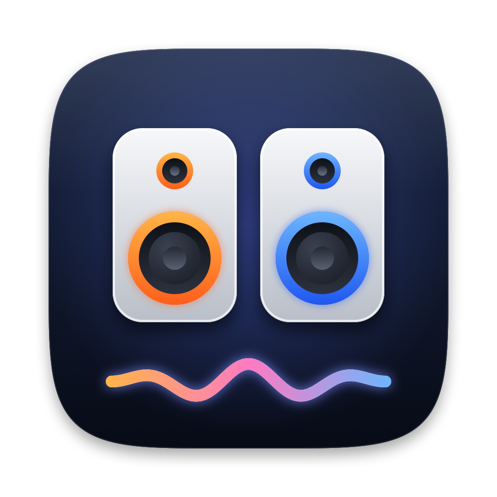
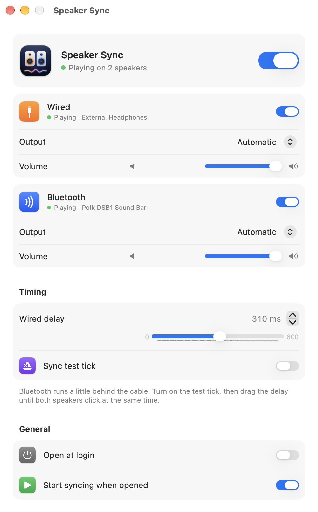

<p align="center">
  
</p>

<h1 align="center">Speaker Sync</h1>

<p align="center">
  Play your Mac's audio on a Bluetooth speaker and a wired speaker at the same time, perfectly in sync.
</p>

<p align="center">
  
</p>

---

## Why this exists

I had a Polk soundbar on Bluetooth and a pair of Edifier speakers on an aux cable, and I wanted music coming out of both at once.

macOS can sort of do this already. Audio MIDI Setup has a "Multi-Output Device" that sends sound to two outputs. The problem is Bluetooth runs a couple hundred milliseconds behind a cable, so the two speakers echo off each other. macOS gives you no way to fix that.

Speaker Sync fixes it. It holds back the wired speaker by exactly the amount the Bluetooth one lags, so they land together. You tune it once with a test click and it remembers.

On my setup (Polk DSB1 + Edifier on the headphone jack) the sweet spot is **310 ms**. Yours will be different, which is why there's a slider.

## Features

- **One switch** to send all Mac audio to both speakers
- **Wired delay slider** (0 to 600 ms) to line the speakers up
- **Sync test tick** that clicks every 0.8 seconds so you can tune by ear
- **Per-speaker volume and on/off**
- **Automatic outputs.** Wired picks the headphone jack when something's plugged in. Bluetooth picks the first connected Bluetooth speaker.
- **Recovers on its own.** If the Bluetooth speaker drops or macOS switches outputs, it picks back up within a couple seconds.
- **Menu bar control**, open at login, and start syncing on launch
- **Turning it off puts your Mac back** on whatever output you had before

## How it works

```
Mac apps ──► BlackHole 2ch (virtual audio cable)
                 │
                 ├──► sox ──► delay 310 ms ──► Wired speaker (aux / headphone jack)
                 │
                 └──► sox ─────────────────► Bluetooth speaker
```

1. While syncing, your Mac's output is set to [BlackHole](https://github.com/ExistentialAudio/BlackHole), a free virtual audio cable.
2. Two [sox](https://sourceforge.net/projects/sox/) processes listen to that cable. One plays to the Bluetooth speaker. The other adds the delay and plays to the wired speaker.
3. The app is a small native SwiftUI wrapper that manages those processes, watches for devices coming and going, and gives you the controls.

That's why the app asks for **microphone access**. It's listening to the BlackHole cable, not your mic.

## Install

You need macOS 14 or later and [Homebrew](https://brew.sh).

**1. Install the two audio tools**

```bash
brew install sox
brew install --cask blackhole-2ch
```

BlackHole asks for your password. After it finishes, restart the audio service (or just reboot):

```bash
sudo killall coreaudiod
```

**2. Get the app**

Grab `Speaker-Sync.zip` from the [latest release](../../releases/latest), unzip it, and drag **Speaker Sync** into Applications.

The app isn't notarized by Apple, so the first time macOS will block it. Right-click the app and choose **Open**, or run:

```bash
xattr -dr com.apple.quarantine "/Applications/Speaker Sync.app"
```

**Or build it yourself** (needs Xcode command line tools):

```bash
git clone https://github.com/callmefoad/speaker-sync.git
cd speaker-sync
./build.sh
```

That builds the app and installs it to `~/Applications`.

## Using it

1. Connect your Bluetooth speaker and plug the wired one into the headphone jack.
2. Open Speaker Sync and flip the big switch on. Allow the microphone prompt.
3. Turn on **Sync test tick**.
4. Drag **Wired delay** until both speakers click at the exact same moment.
5. Turn the tick off and play something.

## Known limits

- **The Mac's volume keys** control the BlackHole cable while syncing. Use the per-speaker sliders, or the speakers' own volume.
- **Very long sessions** can drift slightly between the two speakers since they run on separate clocks. Toggling sync off and on resets it.
- **One wired + one Bluetooth.** More speakers is on the list below.

## Ideas / roadmap

- Auto-calibrate the delay using the Mac's microphone
- Per-speaker profiles that remember the right delay for each Bluetooth device
- More than two speakers
- Keyboard shortcut to toggle sync
- Replace sox with a built-in Core Audio engine (no Homebrew needed, lower latency, drift correction)

Pull requests welcome.

## Files

| File | What it is |
|---|---|
| `main.swift` | The whole app: Core Audio device handling, the sync engine, and the SwiftUI interface |
| `make_icon.swift` | Draws the app icon in code |
| `build.sh` | Builds the icon and app bundle, signs it, installs to `~/Applications` |

## License

MIT. Do whatever you want with it.
